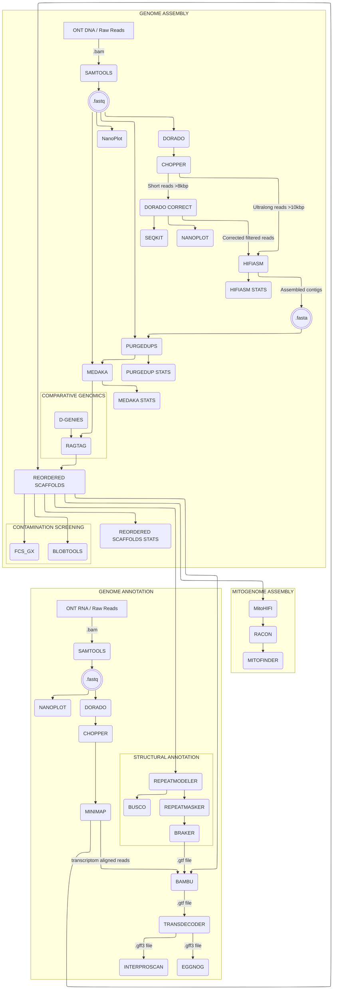

# *Antipathella fiordensis* reference genome pipeline
This repository contains the code and documentation for the pseudo-chromosomal reference genome and RNA-informed annotation of the black coral *Antipathella fiordensis*, assembled with Oxford Nanopore long-read and cDNA sequencing, described in the manuscript:

CITATION HERE

___

## General Pipeline Description

### Genome Assembly

The pseudo-chomosomal reference genome assembly is fully documented in [GENOME ASSEMBLY DOCUMENTATION](GENOME_ASSEMBLY.md).

### Annotation

The RNA-informed annotation is fully documented in the [ANNOTATION DOCUMENTATION](ANNOTATION.md).